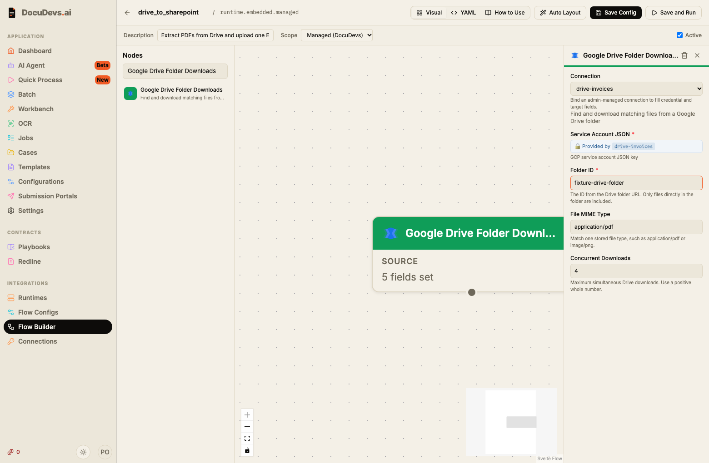
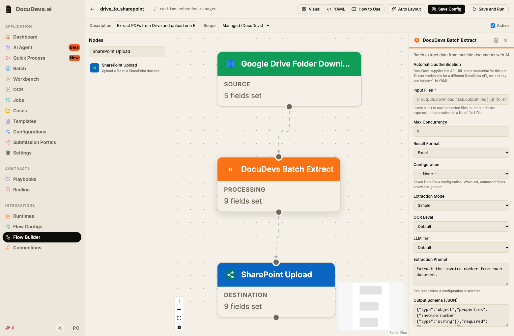
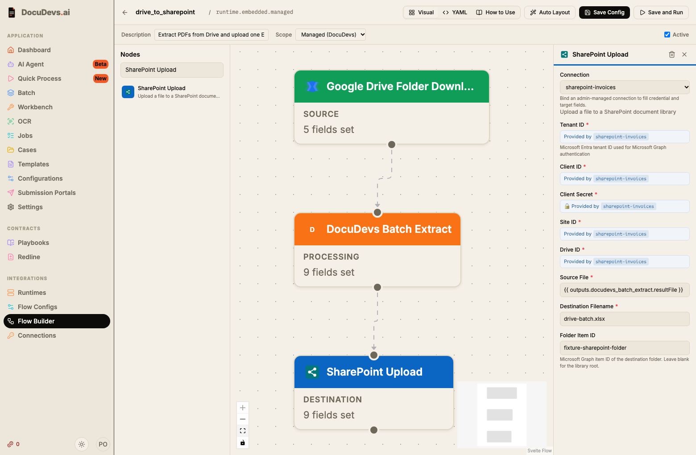
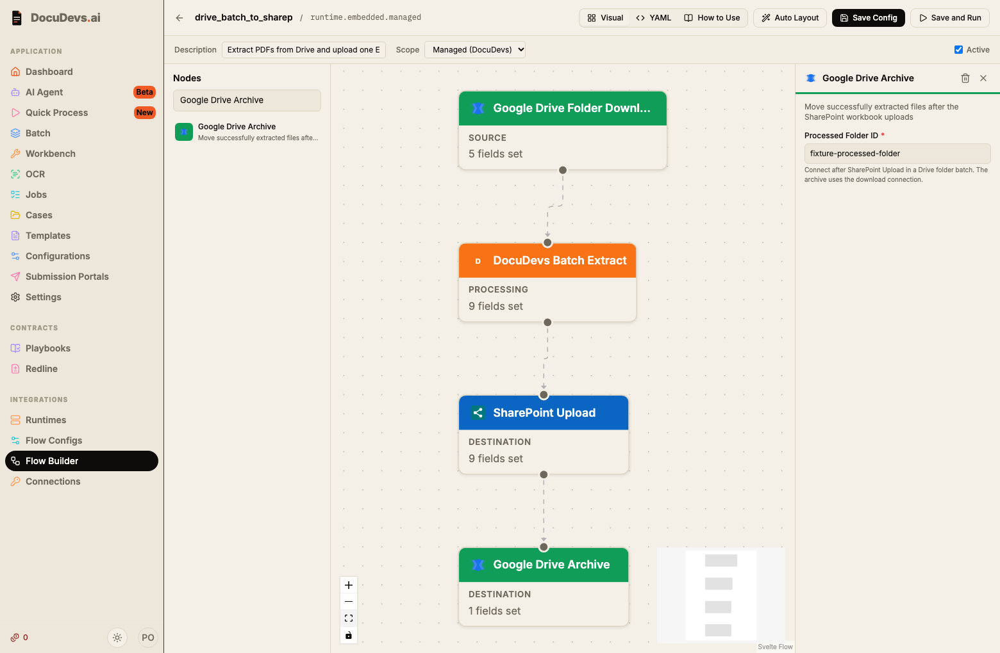

Use Flow Builder to download invoice PDFs from a Google Drive folder, extract their invoice numbers in one DocuDevs batch, upload the workbook to SharePoint, and move the processed PDFs to a Drive archive folder.


## Set up the shared connections

Create sibling folders named **Inbox** and **Processed** in the same Google shared drive. Put two test PDFs with different invoice numbers into **Inbox**. Choose a SharePoint document library where you can check the result. Use a DocuDevs deployment with managed runs and the **Google Drive Archive** node available.

An organization admin creates the following connections under **Integrations → Connections → New connection**. See the provider setup instructions for [Google Workspace](./integration-connections.md#google-workspace) and [SharePoint](./integration-connections.md#sharepoint).

1. **Google Workspace**. Enter the service-account JSON and save the connection as `drive-invoices`. Grant the service account **Content manager** access on the shared drive or the common parent of the two folders. Copy each folder ID from the part of its URL after `/folders/`. [Google Drive roles and permissions](https://developers.google.com/workspace/drive/api/guides/ref-roles)
2. **SharePoint**. Enter the Entra tenant ID, client ID, and client secret for an app with write access to the site. Save the site ID and library drive ID on the connection. Name it `sharepoint-invoices`. If the workbook goes in an existing subfolder, copy its Graph folder item ID.

## Build the workflow

Open **Integrations → Flow Builder**, name the flow `drive_to_sharepoint`, and set **Scope** to **Managed (DocuDevs)**.

### Download the PDFs

Drag **Google Drive Folder Downloads** onto the canvas. Select `drive-invoices` as the **Connection** and enter the **Inbox** folder ID. Keep **File MIME Type** set to `application/pdf` and **Concurrent Downloads** set to `4`.

The node lists the folder on every run and downloads matching files directly in that folder. New PDFs are picked up on the next run. An empty source folder skips extraction and upload.



### Extract the invoice numbers

Add **DocuDevs Batch Extract** and connect the output of **Google Drive Folder Downloads** to its input. Leave **Input Files** blank so the builder passes the downloaded files to the batch.

Choose **Excel** for **Result Format** and **Simple** for **Extraction Mode**. Enter `Extract the invoice number from each document.` as the **Extraction Prompt**, and paste the following JSON into **Output Schema**.

```json
{
  "type": "object",
  "properties": {
    "invoice_number": { "type": "string" }
  },
  "required": ["invoice_number"]
}
```

Batch Extract shows **Automatic authentication** in managed scope. DocuDevs supplies the API URL and a short-lived credential for the run.



### Upload the workbook

Add **SharePoint Upload** and connect the output of **DocuDevs Batch Extract** to its input. Select `sharepoint-invoices` as the **Connection** and set **Destination Filename** to `drive-batch-{{ execution.id }}.xlsx` to keep one workbook per run. Leave **Folder Item ID** blank to upload to the library root, or enter the subfolder item ID.



### Archive processed PDFs in Google Drive

Add **Google Drive Archive** and connect the output of **SharePoint Upload** to its input. Enter the **Processed Folder ID**. The archive step uses the Google Workspace connection from **Google Drive Folder Downloads**.



After SharePoint confirms the upload, the archive step moves the original PDFs with successful results from **Inbox** to **Processed**. It updates the folder in Google Drive. Failed documents stay in **Inbox** for the next run. If the upload fails, every source file stays in **Inbox**. [Move files between folders in Google Drive](https://developers.google.com/workspace/drive/api/guides/folder#move_files_between_folders)

## Run the flow and check the result

1. Click **Save and Run** and wait for the execution to show **COMPLETED**.
2. Open the new workbook in SharePoint and check that the `invoice_number` column contains both expected invoice numbers. Confirm the two original PDFs are in **Processed**.
3. Add a third invoice PDF to **Inbox** and run the flow again. Check that the new workbook contains only the third invoice and that its PDF is now in **Processed**.


If archiving fails after the workbook uploads, check the execution logs and the service account's move permissions. The archive step retries during the run. If the retries run out, the next run can process and publish any PDFs still in **Inbox** again.

To edit the saved workflow, open **Integrations → Flow Configs** and select **Edit** next to its name. Flow Builder restores the nodes, connections, and settings from the saved workflow and arranges them on the canvas. Workflows with settings the canvas cannot represent open in the YAML editor.

## Run on a schedule

If your deployment has managed scheduling enabled, add a **Schedule** node to the canvas. It applies to the whole workflow. Choose a **Frequency** such as **Every hour** or **Weekdays at 08:00**. The preset fills in the **Cron Expression**, which you can edit for a custom cadence. Set the **Time Zone** to match your schedule. For example, **Weekdays at 08:00** with `Europe/Zurich` runs at 08:00 on weekdays in Zurich.

Set the **Schedule timeout**, keep **Active** checked, and click **Save Config**. The builder shows the next scheduled run. Clear **Active** and save again to pause the schedule.

Once the schedule is active, put new PDFs in **Inbox**. Each run scans that folder and archives the successful PDFs after it publishes the workbook. An empty inbox skips extraction, upload, and archiving, though the scheduled run still uses runner compute.

## Archive files from other sources

The **Google Drive Archive** node works with **Google Drive Folder Downloads**. For other sources, the managed runner bundles the Kestra tasks below. Use them in the workflow YAML. Flow Builder currently wires post-upload archiving for Google Drive only.

| Source | Kestra task | How it archives |
| --- | --- | --- |
| Amazon S3 | `io.kestra.plugin.aws.s3.Copy` | Set `delete: true` to copy the object server-side and remove the source after the copy succeeds. [S3 object moves](https://docs.aws.amazon.com/AmazonS3/latest/userguide/copy-object.html) |
| Azure Blob Storage | `io.kestra.plugin.azure.storage.blob.Copy` | Set `delete: true` to move a blob to another path or container. [Azure Blob Copy task](https://kestra.io/plugins/plugin-azure/v2.4.0/azure-blob-storage/io.kestra.plugin.azure.storage.blob.copy) |
| Google Cloud Storage | `io.kestra.plugin.gcp.gcs.Copy` | Set `delete: true` to copy an object to the archive path and remove the source after the copy succeeds. [GCS Copy task](https://kestra.io/plugins/plugin-gcp/google-cloud-storage-gcs/io.kestra.plugin.gcp.gcs.copy) |
| SharePoint | `io.kestra.plugin.microsoft365.sharepoint.Move` | Move an item by ID to a different folder in the same document library. [Microsoft Graph move operation](https://learn.microsoft.com/en-us/graph/api/driveitem-move?view=graph-rest-1.0) |

For scheduled batch workflows, keep **After Download** set to **None** on the **S3 Downloads** and **Azure Blob Downloads** nodes. Their **Move** and **Delete** actions run as part of the download step, before extraction and publication.

In the workflow YAML, keep the original object keys or SharePoint item IDs alongside the downloaded file references. Enable `includeSuccessfulFiles: true` on **DocuDevs Batch Extract** and use its `successfulFiles` output to select the originals to archive. Run the archive tasks only after the destination confirms the upload. Use the files from that batch so failed documents and files that arrived during the run stay available for the next schedule.
