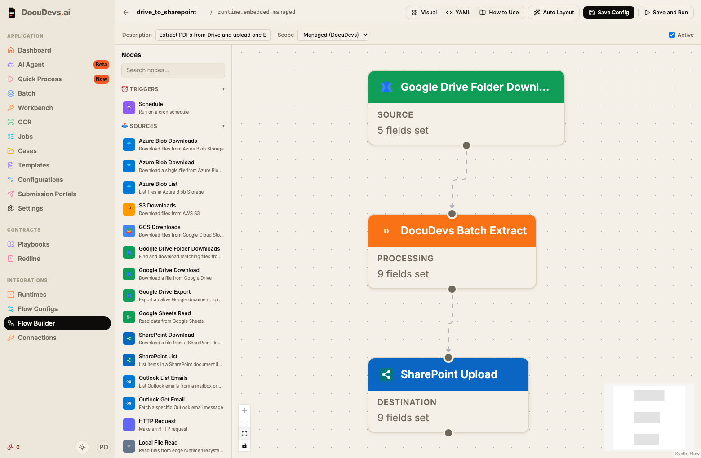
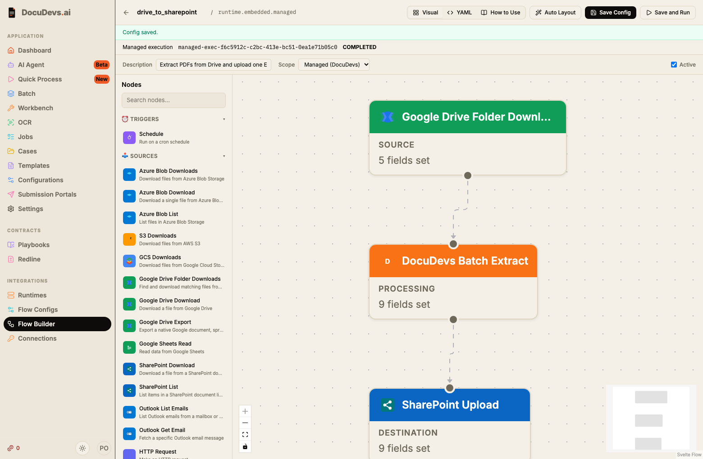

Use Flow Builder to download invoice PDFs from a Google Drive folder, extract their invoice numbers in one DocuDevs batch, and upload the workbook to a SharePoint document library.



## Set up the shared connections

Start with a Drive folder containing two invoice PDFs with different invoice numbers and a SharePoint document library where you can check the result. Use a DocuDevs deployment with managed runs enabled.

An organization admin creates the following connections under **Integrations → Connections → New connection**. See the provider setup instructions for [Google Workspace](./integration-connections.md#google-workspace) and [SharePoint](./integration-connections.md#sharepoint).

1. **Google Workspace**. Enter the service-account JSON and share the source folder with the service account. Save the connection as `drive-invoices`. Copy the folder ID from the part of its Drive URL after `/folders/`.
2. **SharePoint**. Enter the Entra tenant ID, client ID, and client secret for an app with write access to the site. Save the site ID and library drive ID on the connection. Name it `sharepoint-invoices`. If the workbook goes in an existing subfolder, copy its Graph folder item ID.

## Build the workflow

Open **Integrations → Flow Builder**, name the flow `drive_to_sharepoint`, and set **Scope** to **Managed (DocuDevs)**.

### Download the PDFs

Drag **Google Drive Folder Downloads** onto the canvas. Select `drive-invoices` as the **Connection** and enter the **Folder ID**. Keep **File MIME Type** set to `application/pdf` and **Concurrent Downloads** set to `4`.

The node lists the folder on every run and downloads matching files directly in that folder. New PDFs are picked up on the next run. An empty source folder skips extraction and upload.


### Extract the invoice numbers

Add **DocuDevs Batch Extract** and connect the output of **Google Drive Folder Downloads** to its input. Leave **Input Files** blank so the builder passes the downloaded files to the batch.

Choose **Excel** for **Result Format** and **Simple** for **Extraction Mode**. Enter `Extract the invoice number from each document.` as the **Extraction Prompt**, and paste the following JSON into **Output Schema**.

```json
{
  "type": "object",
  "properties": {
    "invoice_number": { "type": "string" }
  },
  "required": ["invoice_number"]
}
```

Batch Extract shows **Automatic authentication** in managed scope. DocuDevs supplies the API URL and a short-lived credential for the run.


### Upload the workbook

Add **SharePoint Upload** and connect the output of **DocuDevs Batch Extract** to its input. Select `sharepoint-invoices` as the **Connection** and set **Destination Filename** to `drive-batch.xlsx`. Leave **Folder Item ID** blank to upload to the library root, or enter the subfolder item ID.


## Run the flow and check the workbook

1. Click **Save and Run** and wait for the execution to show **COMPLETED**.
2. Open `drive-batch.xlsx` in the destination SharePoint library or folder. Check that the `invoice_number` column contains the two expected invoice numbers.
3. Add a third invoice PDF to the Drive folder and run the flow again. Check that the new workbook includes its invoice number.



If a run fails or produces no workbook, check the execution status, the source folder ID and service-account access, and the SharePoint app's write permission on the destination site.

## Archive processed PDFs in Google Drive

1. Create sibling folders named **Inbox** and **Processed** in the same Drive or shared drive. Put new PDFs in **Inbox**. Set **Folder ID** on **Google Drive Folder Downloads** to the ID of **Inbox** and give the Google Workspace service account read access to it. The person archiving files needs permission to move them between the folders.
2. Set **Destination Filename** on **SharePoint Upload** to `drive-batch-{{ execution.id }}.xlsx` to keep a separate workbook for each run.
3. Run the workflow with two test invoices that have distinct invoice numbers. After it uploads the workbook, compare the `invoice_number` column with the PDFs in **Inbox**. In Google Drive, select the PDFs you can match to the workbook and choose **Move** to send them to **Processed**. Leave failed or unmatched PDFs in **Inbox** for retry.
4. Add a new PDF and run the workflow again. Check that the new workbook includes the new invoice and any successful retries. The source reads **Inbox**, so archived PDFs stay out of later runs.

The move is manual. The Batch Extract node's Excel output does not expose per-file status mapped to Drive file IDs, which an automated move would need.

## Run on a schedule

If your deployment has managed scheduling enabled, add a **Schedule** node to the flow. Enter a five-field **Cron Expression** and an optional **Time Zone**. For example, `0 8 * * MON-FRI` with `Europe/Zurich` runs at 08:00 on weekdays in Zurich. Set the **Schedule timeout**, keep **Active** checked, and click **Save Config**. The builder shows the next scheduled run. Clear **Active** and save again to pause the schedule.

Review each workbook and move its confirmed PDFs before the next scheduled run. Any matching PDF still in **Inbox** is picked up again. An empty inbox skips extraction and upload, though the scheduled run still uses runner compute.
